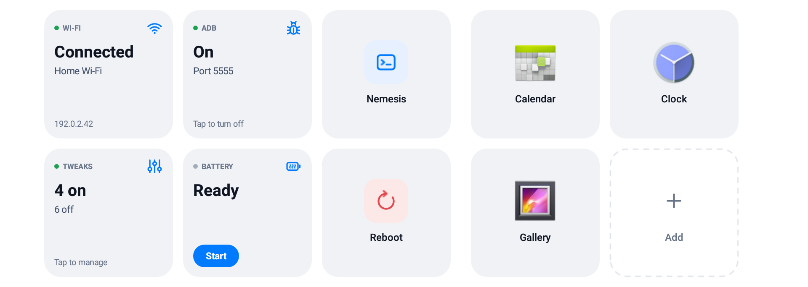
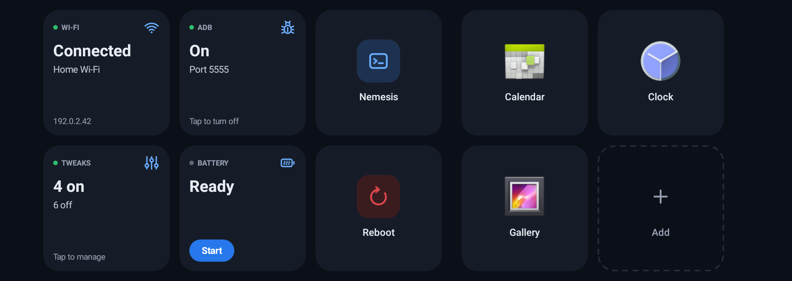

# Tilepad Simple

[Tilepad](https://github.com/KramerTech/gen5-Tilepad) with a cleaner look, for Hyundai/Kia/Genesis Gen5W head units (Android 4.4), installed through [NEMESIS](https://github.com/xwtk/hmg_nemesis). It works the same as Tilepad; only the screens are different.




*Screenshots are from an emulator at the head unit's 1920×720 size.*

Hold the steering wheel's **★** button for about a second to open it. Hold it again to close it. A short ★ press still does whatever Hyundai's Button settings assign to it.

## What's different from Tilepad

- **Day and night.** Colors follow the head unit's Day/Night display setting, in the same style as [gen5w-preconditioning-simple](https://github.com/mbudden/gen5w-preconditioning-simple).
- **Tiles say one thing at a glance:** a status dot, one big word (*Connected*, *On*, *Ready*), and one short line.
- **Battery** has a **Start** button right on the tile, and shows the elapsed time while it waits for the car.
- **Shortcut icons stay visible.** An icon that would blend into its tile gets a thin edge or a gray plate behind it.
- **Shorter text** on tiles and popups.

The bundled Tweaks app is unchanged.

## What it does

- **Wi-Fi:** network, IP and signal. Tap to pick a network, or to turn on the Wi-Fi client on a unit whose Wi-Fi only runs the CarPlay/Android Auto hotspot.
- **Battery preconditioning** (EVs only): one tap to start, one to stop. Based on [Launchpad](https://github.com/paytondevs/gen5w-preconditioning)'s backend.
- **Tweaks:** automatic DST, startup-brief bypass, cold-boot heaters, track-button swap, climate sync options, auto-open phone projection, Charge-Away, and more. All start off. See [docs/TWEAKS.md](docs/TWEAKS.md).
- **ADB over Wi-Fi** on and off.
- **Nemesis** (opens NEMESIS Manager) and **Reboot** (asks first).
- **Shortcuts** to any screen, including Hyundai and system screens with no icon. Long-press to move, rename or remove them.

Tiles a car can't back (Wi-Fi without a Wi-Fi module, Battery on a gas car) don't appear. Every tile in detail: [docs/TILES.md](docs/TILES.md).

> ⚠️ **While ADB is on, any computer that can reach the head unit can get a root shell without approval**, including over the car's cellular modem. Wireless CarPlay and Android Auto also stop working, because ADB needs Wi-Fi on. Turn it on only while you need it.

## Install

You need NEMESIS. Tilepad Simple is signed with its own key, so it can't install over anything that's already there:

- **KramerTech's Tilepad:** uninstall it first with its `Tilepad-uninstall-usb.zip`, then reboot.
- **Launchpad:** uninstall it first with its `Launchpad-uninstall-usb.zip`, then reboot.
- **[HMG-API](https://github.com/VysseCodes/HMG-API):** can't be installed alongside; uninstall it first.

Then:

1. Download **`Tilepad-install-usb.zip`** from the [latest release](https://github.com/mbudden/gen5-Tilepad-simple/releases/latest).
2. Extract it so its contents sit at the root of a FAT32 or exFAT drive, with nothing else from NEMESIS on it:
   ```text
   USB/
   ├── NEMESIS.data
   ├── packages/tilepad.zip      (don't unzip this)
   └── tilepad/{common,lib,install}.sh
   ```
3. Parked, with the head unit fully booted, plug the drive in and tap **Yes** on the NEMESIS prompt. Wait for the result.
4. Reboot the head unit (pinhole button), remove the drive, and hold ★.

The installer writes `tilepad-install.log` to the drive.

**Updating:** same steps with `Tilepad-update-usb.zip`. Your tiles are kept.

**Uninstalling:** same steps with `Tilepad-uninstall-usb.zip`. It turns off anything Tilepad turned on (ADB, the Wi-Fi client, tweaks) and restores the files tweaks changed.

## Compatibility

Developed on an IONIQ 5 (NEEV23 US). Preconditioning supports ten exact firmware profiles across US/Korean IONIQ 5 and EV6 and the US IONIQ 6; on other firmware it won't send commands. Tweaks support USA firmware `V015.012.260507` and `V016.010.260903`; on other firmware an unavailable tweak offers a compatibility log for an issue report.

If something goes wrong, NEMESIS Manager → Logs → Copy to USB, or `adb logcat | grep -i tilepad`.

## Building

See [docs/BUILDING.md](docs/BUILDING.md).

## Credits

[Tilepad](https://github.com/KramerTech/gen5-Tilepad) by KramerTech, which this is a fork of. [NEMESIS](https://github.com/xwtk/hmg_nemesis), Launchpad by paytondev, [Ioniq5_CAN](https://github.com/tylerharvey/Ioniq5_CAN), [gen5w-utils](https://github.com/Helloyunho/gen5w-utils).
